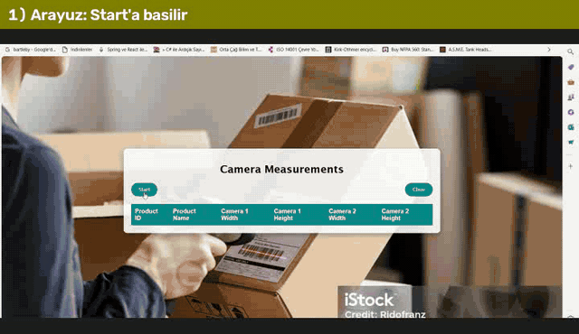
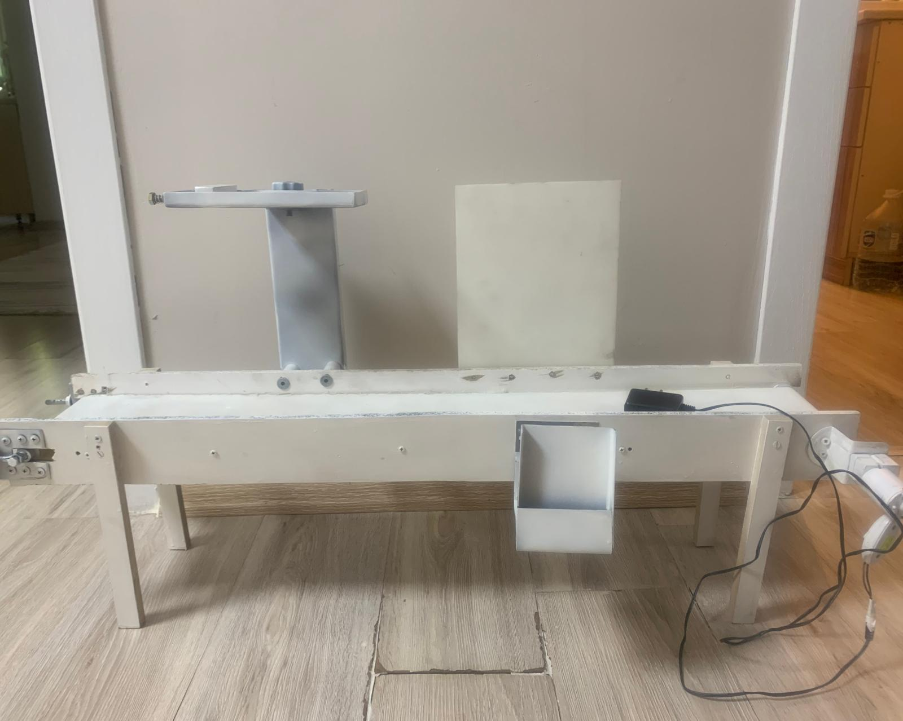
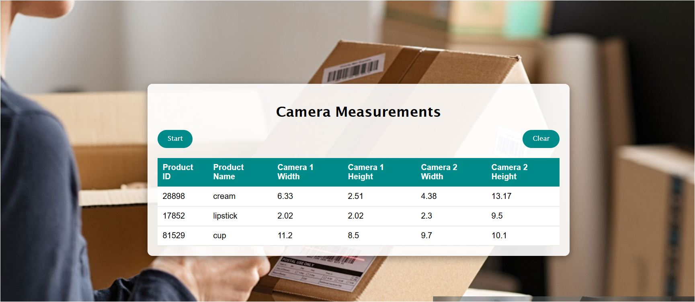
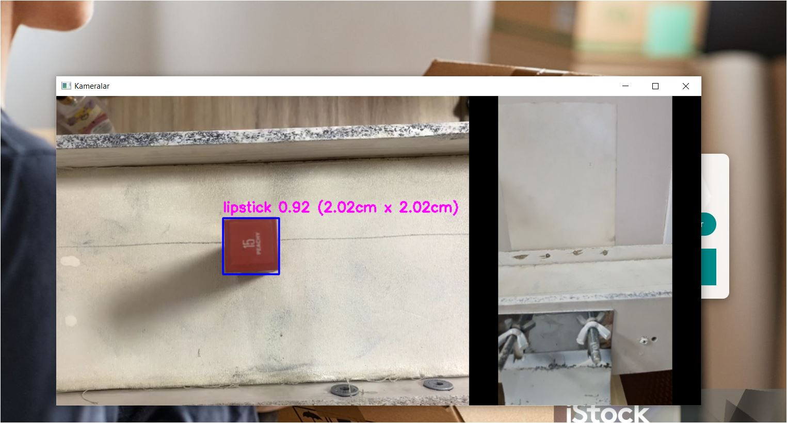
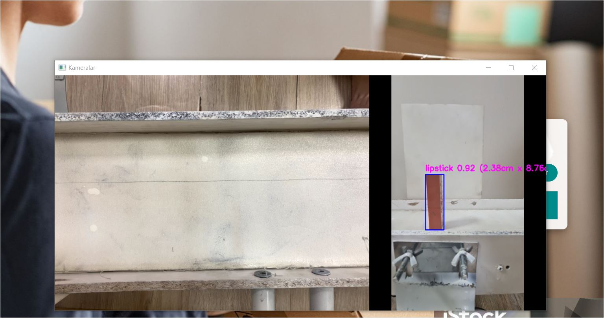
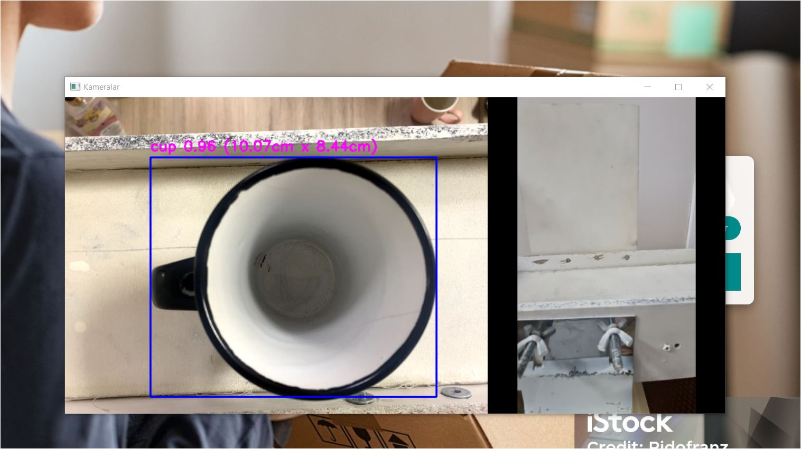
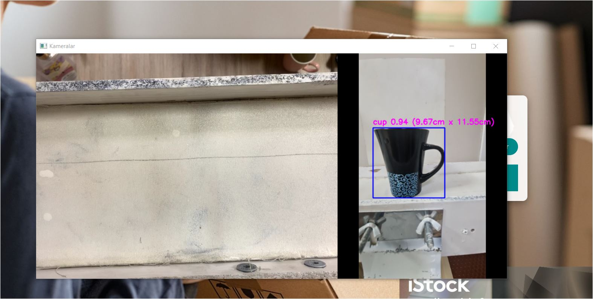
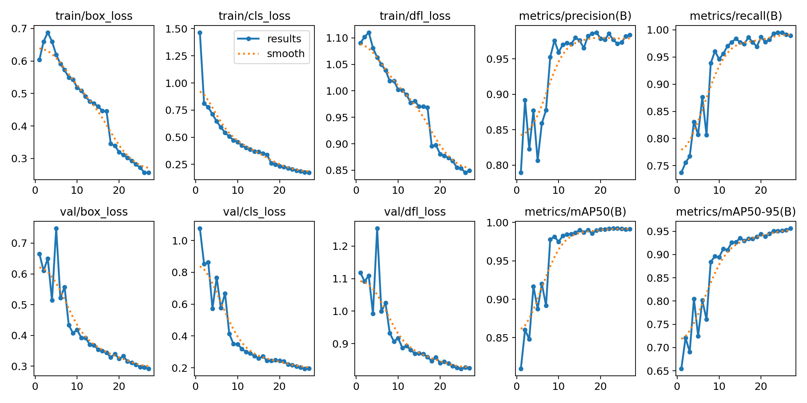
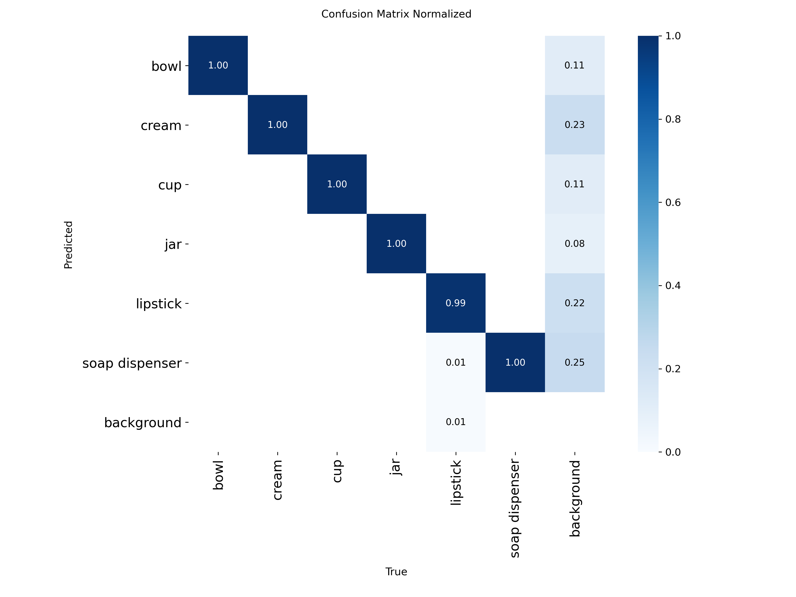
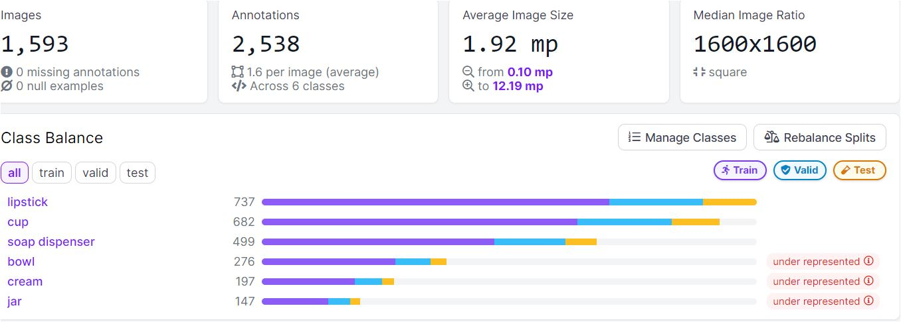

# Conveyor Object Dimensioning — Real-Time Product Detection & Measurement

🇬🇧 **English** | 🇹🇷 [Türkçe](README.tr.md)

A system that **detects, classifies and measures products in real time** as they move along a conveyor belt, using two cameras (top + side). Detected products and their dimensions (in cm) are stored in a database and shown in a web interface. The goal is to automatically determine the right box size for each item in cargo packaging.

**Stack:** Python · YOLOv8 (Ultralytics) · OpenCV · Django · SQLite · Roboflow · Google Colab

> Graduation project — Gazi University, Department of Computer Engineering (BM495/BM496, 2023–2024)
> **Çağla Bal**, **Seçil Sarıgül** · Advisor: Prof. Dr. Hacer Karacan



*Recording of the original system (June 2024): start from the web UI → detection and cm measurement on both cameras → measurements written to the table.*

---

## Contents
- [How it works](#how-it-works)
- [Results](#results)
- [Dataset & training](#dataset--training)
- [Installation & usage](#installation--usage)
- [Calibration](#calibration)
- [Repository structure](#repository-structure)
- [How the project evolved](#how-the-project-evolved)
- [Limitations & notes](#limitations--notes)

---

## How it works

```
 Top camera  ─┐                                        ┌─> width × length (cm)
              ├─> YOLOv8s (6 classes) ─> bounding box ─┤                        ─> product record ─> SQLite ─> Django UI
 Side camera ─┘                                        └─> width × height (cm)
```

1. **Detection:** Every frame from both cameras is passed to a YOLOv8s model trained on our own dataset. Each product is assigned to one of 6 classes: `bowl`, `cream`, `cup`, `jar`, `lipstick`, `soap dispenser`.
2. **Measurement:** The pixel size of the bounding box is converted to centimetres using **pixel/cm ratios** calibrated with a reference object. Since the cameras are mounted at a fixed distance from the belt, the ratios are constant.
3. **Product matching:** A product seen by the top camera opens a new product record; when the same class is seen by the side camera, its height is added to that record. A 2-second gap between detections marks a new product.
4. **Storage & UI:** Measurements are written to SQLite through a Django model (`Measurement`) and shown in a table to the logged-in operator. User registration/login and the Django admin panel are included.

| Conveyor belt (built by us) | Measurement UI |
|---|---|
|  |  |

---

## Results

### Detection and measurement on the conveyor (2024)

| Lipstick — top camera | Lipstick — side camera |
|---|---|
|  |  |

| Cup — top camera | Cup — side camera |
|---|---|
|  |  |

In the final report, measured dimensions were compared with physical measurements taken with a measuring tape, and detection confidence on the belt was reported at ~92–94%.

### Model metrics (YOLOv8s, 27 epochs)

| Evaluation | Precision | Recall | mAP50 | mAP50-95 |
|---|---|---|---|---|
| Final report (2024), validation | 0.984 | 0.986 | 0.991 | 0.960 |
| Re-training (2026), validation — 318 images | 0.984 | 0.990 | 0.991 | 0.956 |
| Re-training (2026), **test** — 161 images | 0.994 | 0.994 | 0.995 | 0.966 |

Per-class results on the test set:

| Class | Precision | Recall | mAP50 | mAP50-95 |
|---|---|---|---|---|
| bowl | 0.999 | 1.000 | 0.995 | 0.974 |
| cream | 0.995 | 1.000 | 0.995 | 0.969 |
| cup | 0.985 | 1.000 | 0.995 | 0.970 |
| jar | 0.995 | 1.000 | 0.995 | 0.995 |
| lipstick | 0.996 | 0.988 | 0.995 | 0.931 |
| soap dispenser | 0.994 | 0.979 | 0.995 | 0.954 |

Training curves, confusion matrices and validation predictions: [`training/results/`](training/results/)

| Training curves | Confusion matrix |
|---|---|
|  |  |

> **Note — reproducing the model:** The original weight file used in the project was lost over time. The model was re-trained in 2026 with the dataset version (Roboflow v14) and settings specified in the final report; the resulting metrics match the reported ones within ±0.005. `app/27Epoch.pt` in this repository is the re-trained model.

---

## Dataset & training

- **Data collection:** Instead of using a ready-made dataset, we **photographed the products ourselves** from different angles, under different lighting and in different positions (1,593 original images, 2,538 annotations).
- **Labelling & preprocessing:** Roboflow — auto-orient, resize to 640×640.
- **Augmentation:** 3 outputs per training example · saturation ±27% · exposure ±10% · blur ≤2.5 px · noise ≤0.1% of pixels.
- **Split (v14, 3,821 images after augmentation):** 3,342 train / 318 validation / 161 test.
- **Training:** Google Colab (Tesla T4), starting from pre-trained `yolov8s.pt`, `epochs=27`, `imgsz=800`.
- **Choosing the epoch count:** 25, 27 and 30 epochs were compared. Although 30 epochs scored marginally higher, it showed signs of overfitting in real belt tests, so **27 epochs** was selected.



Training notebooks:
- [`training/Final_Model_Egitimi_v14_27Epoch.ipynb`](training/Final_Model_Egitimi_v14_27Epoch.ipynb) — training of the final model (with outputs)
- [`training/ilk_egitim_v10_mayis2024.ipynb`](training/ilk_egitim_v10_mayis2024.ipynb) — original record of the first training run on an earlier dataset version

The dataset is kept in the team's private Roboflow workspace and is not included in this repository. To run the notebook with your own dataset, add `ROBOFLOW_API_KEY` under Colab **Secrets** — the key is never written into the code.

---

## Installation & usage

**Requirements:** Python 3.10–3.12, at least one webcam (two cameras for the full setup).

```bash
git clone https://github.com/secilsarigl/conveyor-object-dimensioning.git
cd conveyor-object-dimensioning/app

python -m venv venv
venv\Scripts\activate          # macOS/Linux: source venv/bin/activate
pip install -r requirements.txt

python manage.py migrate
python manage.py createsuperuser   # create a user to log in with
python manage.py runserver
```

Open `http://127.0.0.1:8000` → log in → **Start**. Products are detected and measured in the *Kameralar* (Cameras) window; press **`q`** with that window focused to stop, and the measurements are written to the table.

- Camera indices are set to `0` (top) and `1` (side) in `views.py`. To list the indices on your machine: `python kamera_test.py`
- If the second camera is not available, the system runs in **single-camera test mode** and records only the first camera's measurements.
- For production, set the `DJANGO_SECRET_KEY` environment variable and use `DJANGO_DEBUG=0`.

> The user interface and code comments are in Turkish.

---

## Calibration

The pixel → cm conversion depends on the camera's distance from the belt. The ratios in the code belong to the original setup:

```python
CAMERA1_RATIOW_PX_CM = 289 / 11.2   # top camera
CAMERA1_RATIOH_PX_CM = 253 / 9.2
CAMERA2_RATIOW_PX_CM = 277 / 11     # side camera
CAMERA2_RATIOH_PX_CM = 226 / 7
```

To recompute them for your own setup with a reference object of known size:

```bash
python prototypes/04_kalibrasyon/kalibrasyon.py --camera 0 --width-cm 11.2 --height-cm 9.2
```

---

## Repository structure

```
├── app/                          Django application (final system)
│   ├── 27Epoch.pt                trained YOLOv8s model (6 classes)
│   ├── camera_app/views.py       camera loop, detection, cm measurement, saving
│   ├── camera_app/models.py      Measurement model
│   ├── camera_app/templates/     welcome, login, register, measurement pages
│   └── kamera_test.py            camera/driver diagnostic tool
├── training/                     training notebooks and result plots
├── prototypes/                   early experiments showing how the measurement method evolved
├── docs/                         final report (PDF, Turkish), poster and README images
└── demo/                         system demo GIF
```

---

## How the project evolved

The [`prototypes/`](prototypes/) folder shows, in chronological order, how we arrived at the final system:

1. **Classical image processing:** Canny edges + contours, measuring against a reference object. It did not know *what* an object was, so shadows and background texture disturbed the measurements.
2. **YOLO + measurement (hazelnut experiment):** first attempt at converting a detection box into centimetres.
3. **Webcam measurement with a pre-trained segmentation model:** the measurement pipeline worked, but the pre-trained (COCO) model did not recognise our products, so we built our own dataset.
4. **Final system:** our own 6-class model, two cameras, Django UI and database.

---

## Limitations & notes

- **Fixed-distance assumption:** Measurement assumes products are always at the same distance from the camera; the error grows for products of different heights. The report recommends a tolerance of ±2 units when packaging. Intrinsic camera calibration and depth information could improve this.
- **2026 updates:** While preparing this repository, the following fixes were applied to the original code (marked in the code with `[DÜZELTİLDİ]` / `[YENİDEN YAZILDI]`):
  - images are passed to the model in BGR (the original code swapped the colour channels),
  - on Windows, cameras are opened with DirectShow (fixes a green-screen issue on some cameras),
  - a field-name bug in the registration form was fixed,
  - a single-camera test mode was added,
  - `SECRET_KEY` was moved to an environment variable and external stock images were replaced with a CSS background.
- `views.py` was reconstructed from the code figures in the final report; the database-saving part, which was not visible in the report, was rewritten.

## More information
- Final report (Turkish): [`docs/BM496_Final_Raporu.pdf`](docs/BM496_Final_Raporu.pdf)
- Poster (Turkish): [`docs/poster.png`](docs/poster.png)
