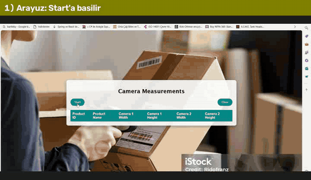
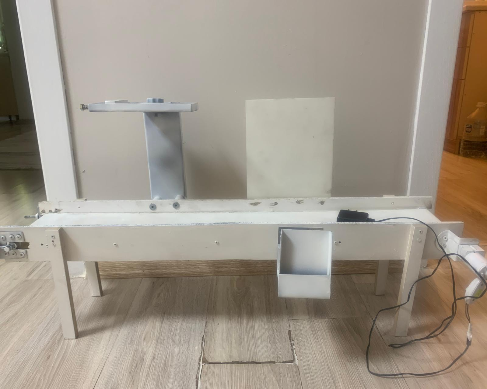
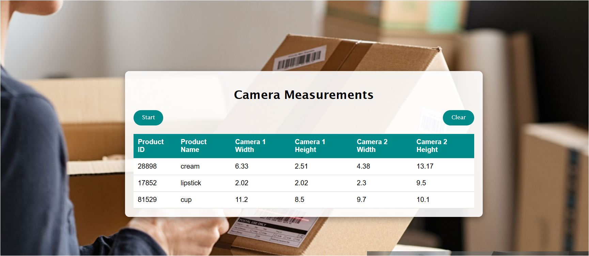
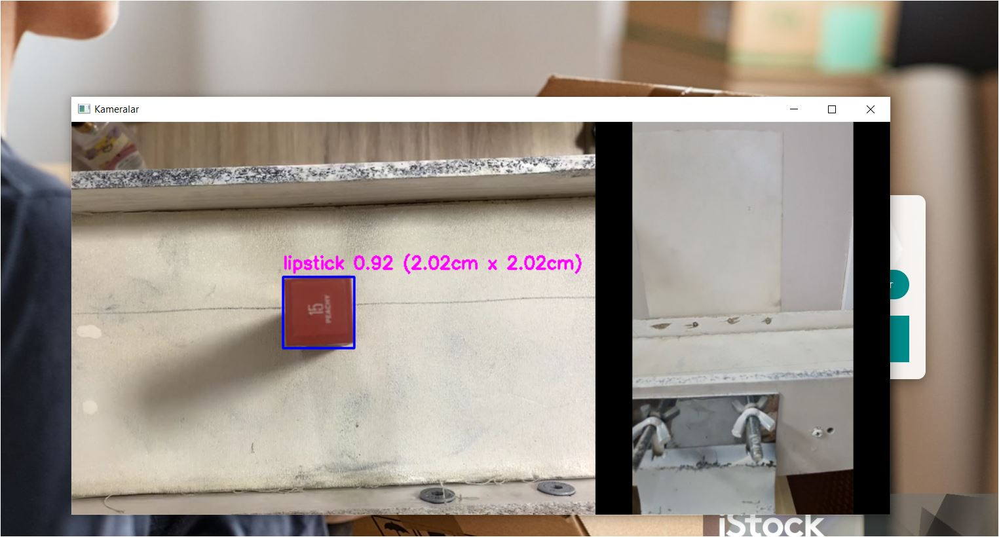
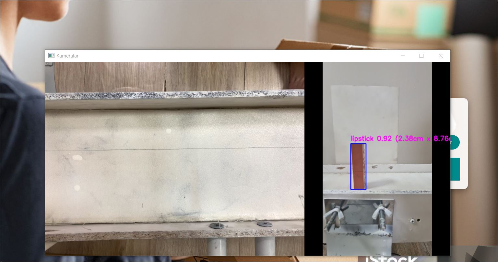
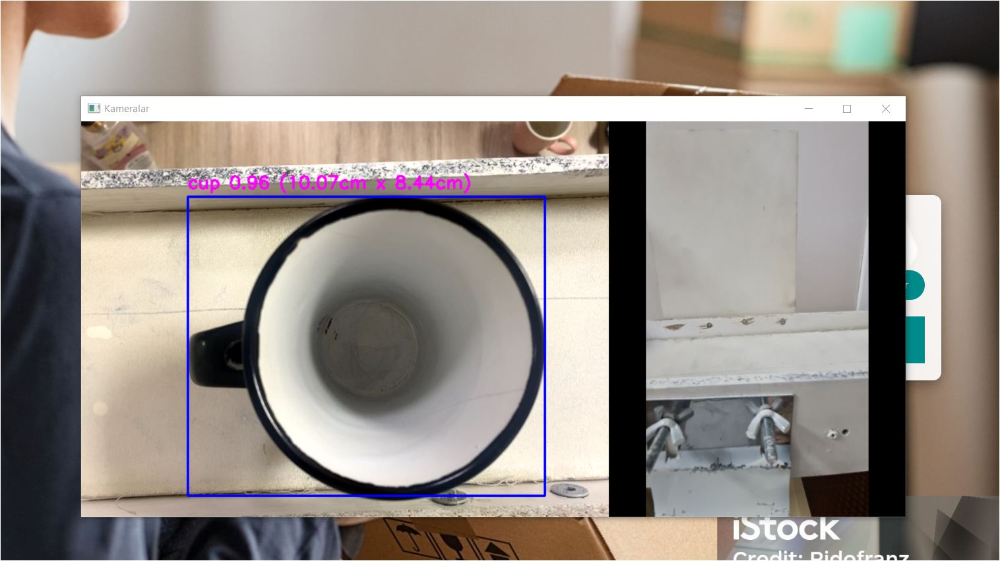
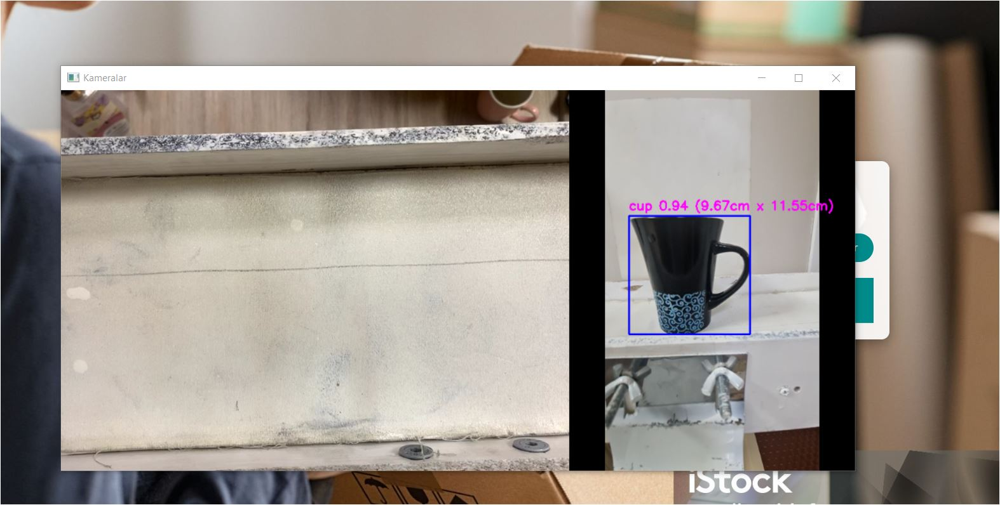
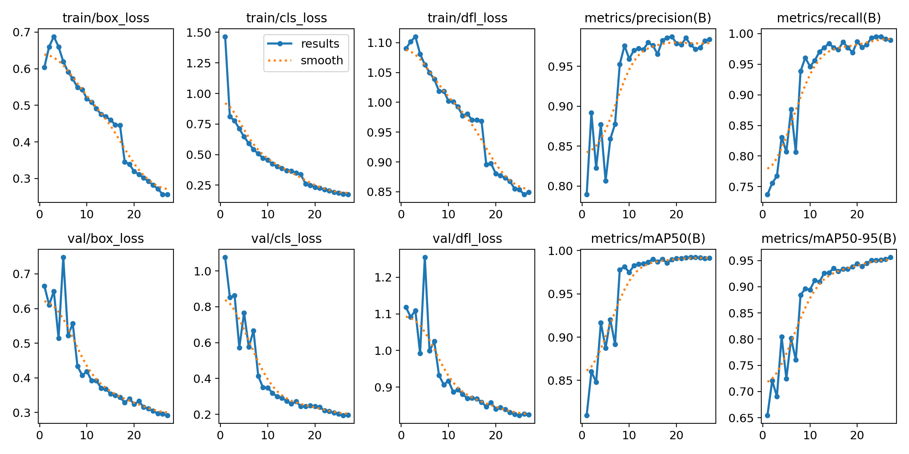
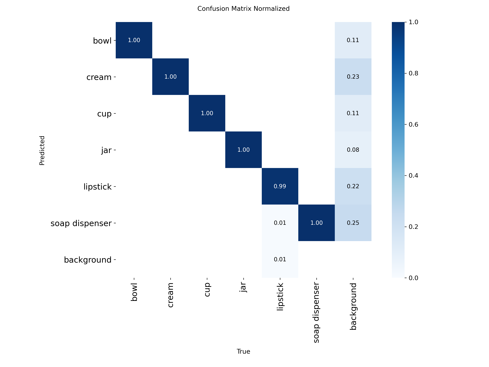
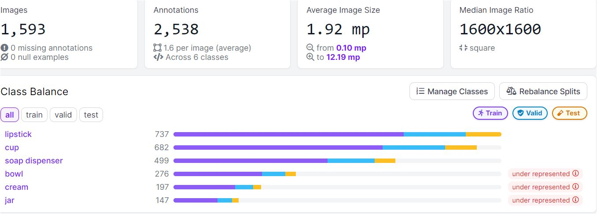

# Konveyör Bantlarda Görüntü İşleme ile Ürün Takibi ve Paketleme

🇬🇧 [English](README.md) | 🇹🇷 **Türkçe**

**Real-time product detection and dimensioning on a conveyor belt with YOLOv8, OpenCV and Django.**

Konveyör banttan geçen ürünleri iki kamerayla (üst + yan) gerçek zamanlı tespit eden, sınıflandıran ve boyutlarını santimetre cinsinden ölçen; sonuçları bir web arayüzünde ve veritabanında tutan bir sistem. Amaç, kargo paketlemede her ürüne uygun kutu boyutunun otomatik belirlenmesi.

> Gazi Üniversitesi Bilgisayar Mühendisliği — BM495/BM496 Bitirme Projesi (2023–2024)
> **Çağla Bal**, **Seçil Sarıgül** · Danışman: Prof. Dr. Hacer Karacan



*Orijinal sistemin çalışma kaydı (Haziran 2024): arayüzden başlatma → iki kamerada tespit ve cm ölçümü → ölçümlerin tabloya yazılması.*

---

## İçindekiler
- [Nasıl çalışır?](#nasıl-çalışır)
- [Sonuçlar](#sonuçlar)
- [Veri seti ve model eğitimi](#veri-seti-ve-model-eğitimi)
- [Kurulum ve çalıştırma](#kurulum-ve-çalıştırma)
- [Kalibrasyon](#kalibrasyon)
- [Proje yapısı](#proje-yapısı)
- [Projenin gelişimi](#projenin-gelişimi)
- [Sınırlamalar ve notlar](#sınırlamalar-ve-notlar)

---

## Nasıl çalışır?

```
 Üst kamera ─┐                                   ┌─> genişlik × uzunluk (cm)
             ├─> YOLOv8s (6 sınıf) ─> bounding box ┤                          ─> ürün kaydı ─> SQLite ─> Django arayüzü
 Yan kamera ─┘                                   └─> genişlik × yükseklik (cm)
```

1. **Tespit:** İki kameradan gelen her kare, kendi veri setimizle eğitilen YOLOv8s modeline verilir. Model ürünü 6 sınıftan birine atar: `bowl`, `cream`, `cup`, `jar`, `lipstick`, `soap dispenser`.
2. **Ölçüm:** Tespit kutusunun piksel boyutları, referans objeyle kalibre edilmiş **piksel/cm oranlarıyla** santimetreye çevrilir. Kameralar banda sabit mesafede monte edildiği için oran sabittir.
3. **Ürün eşleştirme:** Üst kamerada görülen ürün yeni bir ürün kaydı başlatır. Aynı sınıftaki ürün yan kamerada görülünce yükseklik bilgisi bu kayda eklenir. 2 saniyelik boşluk yeni ürün olarak kabul edilir.
4. **Kayıt ve arayüz:** Ölçümler Django modeli (`Measurement`) üzerinden SQLite'a yazılır ve giriş yapan operatöre tabloda gösterilir. Kullanıcı kaydı/girişi ve Django admin paneli bulunur.

| Konveyör bant (kendi tasarımımız) | Ölçüm arayüzü |
|---|---|
|  |  |

**Kullanılan teknolojiler:** Python · YOLOv8 (Ultralytics) · OpenCV · Django · SQLite · Roboflow · Google Colab

---

## Sonuçlar

### Konveyör üzerinde tespit ve ölçüm (2024)

| Ruj — üst kamera | Ruj — yan kamera |
|---|---|
|  |  |

| Bardak — üst kamera | Bardak — yan kamera |
|---|---|
|  |  |

Raporda, ölçülen boyutlar metreyle yapılan gerçek ölçümlerle karşılaştırılmış ve tespit skorlarının ~%92–94 olduğu raporlanmıştır.

### Model metrikleri (YOLOv8s, 27 epoch)

| Değerlendirme | Precision | Recall | mAP50 | mAP50-95 |
|---|---|---|---|---|
| Final rapor (2024), doğrulama | 0.984 | 0.986 | 0.991 | 0.960 |
| Yeniden eğitim (2026), doğrulama — 318 görüntü | 0.984 | 0.990 | 0.991 | 0.956 |
| Yeniden eğitim (2026), **test** — 161 görüntü | 0.994 | 0.994 | 0.995 | 0.966 |

Test setinde sınıf bazında sonuçlar:

| Sınıf | Precision | Recall | mAP50 | mAP50-95 |
|---|---|---|---|---|
| bowl | 0.999 | 1.000 | 0.995 | 0.974 |
| cream | 0.995 | 1.000 | 0.995 | 0.969 |
| cup | 0.985 | 1.000 | 0.995 | 0.970 |
| jar | 0.995 | 1.000 | 0.995 | 0.995 |
| lipstick | 0.996 | 0.988 | 0.995 | 0.931 |
| soap dispenser | 0.994 | 0.979 | 0.995 | 0.954 |

Eğitim grafikleri, karışıklık matrisi ve doğrulama tahminleri: [`training/results/`](training/results/)

| Eğitim eğrileri | Karışıklık matrisi |
|---|---|
|  |  |

> **Not — modelin yeniden üretilmesi:** Projede kullanılan orijinal ağırlık dosyası zamanla kayboldu. Model, final raporda belirtilen veri seti (Roboflow v14) ve ayarlarla 2026'da yeniden eğitildi; elde edilen metrikler rapordakilerle ±0.005 içinde örtüşmektedir. Depodaki `app/27Epoch.pt` bu yeniden eğitilmiş modeldir.

---

## Veri seti ve model eğitimi

- **Veri toplama:** Hazır veri seti yerine 6 sınıfa ait ürünlerin fotoğrafları farklı açı, ışık ve pozisyonlarda **kendimiz çektik** (1.593 özgün görüntü, 2.538 etiket).
- **Etiketleme ve ön işleme:** Roboflow — Auto-Orient, 640×640 yeniden boyutlandırma.
- **Veri artırma:** Örnek başına 3 çıktı · doygunluk ±%27 · pozlama ±%10 · bulanıklık ≤2.5 px · gürültü ≤%0.1 piksel.
- **Bölünme (v14, artırma sonrası 3.821 görüntü):** 3.342 eğitim / 318 doğrulama / 161 test.
- **Eğitim:** Google Colab (Tesla T4), `yolov8s.pt` ön-eğitimli ağırlıklarla, `epochs=27`, `imgsz=800`.
- **Epoch seçimi:** 25, 27 ve 30 epoch karşılaştırıldı; 30 epoch'ta metrikler az farkla daha yüksek olsa da gerçek bant testlerinde aşırı öğrenme gözlendiği için **27 epoch** seçildi.



Eğitim notebook'ları:
- [`training/Final_Model_Egitimi_v14_27Epoch.ipynb`](training/Final_Model_Egitimi_v14_27Epoch.ipynb) — final modelin eğitimi (çıktılarıyla birlikte)
- [`training/ilk_egitim_v10_mayis2024.ipynb`](training/ilk_egitim_v10_mayis2024.ipynb) — önceki veri seti sürümüyle yapılan ilk eğitimin orijinal kaydı

Veri seti, ekibin özel Roboflow çalışma alanında tutulduğu için depoya eklenmemiştir. Notebook'u kendi veri setinizle çalıştırmak için Colab **Secrets** bölümüne `ROBOFLOW_API_KEY` ekleyin; anahtar koda yazılmaz.

---

## Kurulum ve çalıştırma

**Gereksinimler:** Python 3.10–3.12, en az bir webcam (tam sistem için iki kamera).

```bash
git clone https://github.com/secilsarigl/conveyor-object-dimensioning.git
cd conveyor-object-dimensioning/app

python -m venv venv
venv\Scripts\activate          # macOS/Linux: source venv/bin/activate
pip install -r requirements.txt

python manage.py migrate
python manage.py createsuperuser   # giriş için kullanıcı oluşturun
python manage.py runserver
```

Tarayıcıda `http://127.0.0.1:8000` → giriş yapın → **Start**. Açılan *Kameralar* penceresinde ürünler tespit edilip ölçülür; pencere seçiliyken **`q`** ile durdurduğunuzda ölçümler tabloya yazılır.

- Kamera indeksleri `views.py` içinde `0` (üst) ve `1` (yan) olarak tanımlıdır. Bilgisayarınızdaki indeksleri görmek için: `python kamera_test.py`
- İkinci kamera bulunamazsa sistem **tek kamera test modunda** çalışır ve yalnızca 1. kameranın ölçülerini kaydeder.
- Üretim ortamı için `DJANGO_SECRET_KEY` ortam değişkenini ayarlayın ve `DJANGO_DEBUG=0` kullanın.

---

## Kalibrasyon

Piksel → cm dönüşümü kameranın banda uzaklığına bağlıdır. Projedeki oranlar orijinal düzenek içindir:

```python
CAMERA1_RATIOW_PX_CM = 289 / 11.2   # üst kamera
CAMERA1_RATIOH_PX_CM = 253 / 9.2
CAMERA2_RATIOW_PX_CM = 277 / 11     # yan kamera
CAMERA2_RATIOH_PX_CM = 226 / 7
```

Kendi kurulumunuzda boyutu bilinen bir referans obje ile oranları yeniden hesaplamak için:

```bash
python prototypes/04_kalibrasyon/kalibrasyon.py --camera 0 --width-cm 11.2 --height-cm 9.2
```

---

## Proje yapısı

```
├── app/                          Django uygulaması (final sistem)
│   ├── 27Epoch.pt                eğitilmiş YOLOv8s modeli (6 sınıf)
│   ├── camera_app/views.py       kamera döngüsü, tespit, cm ölçümü, kayıt
│   ├── camera_app/models.py      Measurement modeli
│   ├── camera_app/templates/     karşılama, giriş, kayıt, ölçüm sayfaları
│   └── kamera_test.py            kamera/sürücü teşhis aracı
├── training/                     eğitim notebook'ları ve sonuç grafikleri
├── prototypes/                   ölçüm yönteminin gelişimini gösteren ilk denemeler
├── docs/                         final rapor (PDF), poster ve README görselleri
└── demo/                         sistem demo GIF'i
```

---

## Projenin gelişimi

[`prototypes/`](prototypes/) klasörü, final sisteme nasıl ulaşıldığını kronolojik olarak gösterir:

1. **Klasik görüntü işleme** — Canny kenar bulma + kontur ile referans objeye göre ölçüm. Nesnenin *ne olduğunu* bilmediği için gölge ve arka plandan etkilendi.
2. **YOLO + ölçüm (fındık denemesi)** — tespit kutusunu cm'ye çevirme fikri ilk kez denendi.
3. **Hazır segmentasyon modeli ile webcam ölçümü** — ölçüm akışı oturdu; ancak hazır (COCO) model ürünlerimizi tanımadığı için kendi veri setimizi oluşturduk.
4. **Final sistem** — kendi 6 sınıflı modelimiz, iki kamera, Django arayüzü ve veritabanı.

---

## Sınırlamalar ve notlar

- **Sabit mesafe varsayımı:** Ölçüm, ürünlerin kameraya hep aynı uzaklıkta olduğunu varsayar; farklı yükseklikteki ürünlerde hata payı artar. Raporda paketleme için ±2 birimlik pay bırakılması önerilmiştir. Kamera iç parametre kalibrasyonu ve derinlik bilgisi ile iyileştirilebilir.
- **2026 güncellemeleri:** Depo hazırlanırken orijinal koda şu düzeltmeler uygulandı (kodda `[DÜZELTİLDİ]` / `[YENİDEN YAZILDI]` etiketleriyle işaretlidir):
  - Modelin girdisi BGR olarak verildi (orijinal kod renk kanallarını ters çeviriyordu),
  - Windows'ta kameralar DirectShow ile açılıyor (bazı kameralarda yeşil ekran sorunu),
  - Kayıt formundaki alan adı hatası giderildi,
  - Tek kamera test modu eklendi,
  - `SECRET_KEY` ortam değişkenine taşındı, harici stok görseller CSS arka plana çevrildi.
- `views.py`, final rapordaki kod görsellerinden yeniden oluşturulmuştur; raporda görünmeyen veritabanına kaydetme bölümü yeniden yazılmıştır.

## Detaylı bilgi
- Final raporu: [`docs/BM496_Final_Raporu.pdf`](docs/BM496_Final_Raporu.pdf)
- Poster: [`docs/poster.png`](docs/poster.png)
